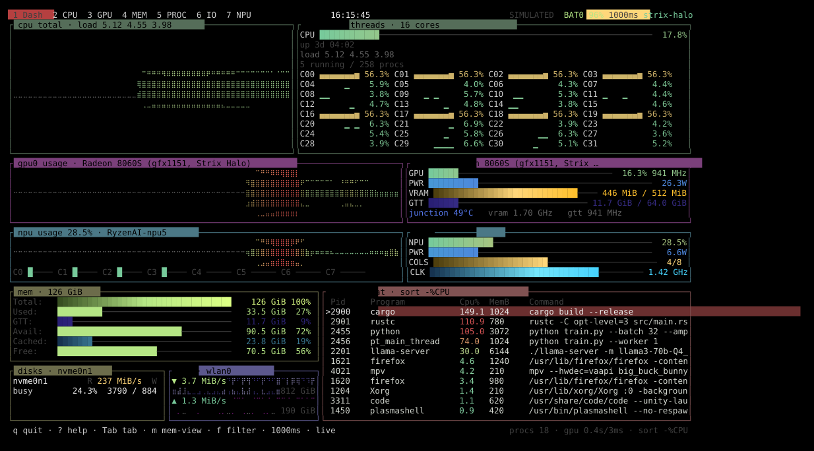

# amdtop

A `btop`-style terminal monitor built for **AMD Strix Halo** (Ryzen AI Max 300
series, Radeon 8000S / `gfx1151`) and other AMD APUs where the CPU and GPU share
one pool of LPDDR5X.

Plain `btop`/`htop` cannot answer the question that matters on these machines:
*how much of my RAM is actually pinned for the GPU, and which process is holding
it?* `amdtop` shows CPU load, GPU load, VRAM, GTT and TTM side by side, plus a
`top`-style process list with per-process GPU memory.

Single static-ish Rust binary, no runtime dependencies, no Python.

```text
 1 Dash  2 CPU  3 GPU  4 MEM  5 PROC  6 IO      20:25:12      BAT0 96%  1000ms  strix-halo
┌ cpu total · load 5.30 4.71 4.12 ───────────────────┐┌ cpu · 32 threads · 16 cores ─────────────────┐
│                                                    ││CPU ██████████████───────────   18.4%         │
│          ⟨total CPU usage histogram⟩               ││up 3d 04:06                                   │
│                                                    ││load 5.30 4.71 4.12                           │
│                                                    ││5 running / 258 procs                         │
│                                                    ││C00 ▆▅▅▅ 58.4% C01 ▆▅▅▅ 58.4% … C31           │
└────────────────────────────────────────────────────┘└──────────────────────────────────────────────┘
┌ gpu0 usage · Radeon 8060S (gfx1151) ───────────────┐┌ gpu0 · Radeon 8060S ─────────────────────────┐
│                                                    ││GPU ███████─────── 19.4% 1.01 GHz             │
│            ⟨GPU usage histogram⟩                   ││PWR ██████████───────       26.2 W            │
│                                                    ││VRAM ████████████ 356 MiB / 512 MiB           │
│                                                    ││GTT ████████─── 14.8 GiB / 64.0 GiB           │
└────────────────────────────────────────────────────┘└──────────────────────────────────────────────┘
┌ mem · 126 GiB ──────────────────────────────┐┌ proc · flat · sort -%CPU ─────────────────────┐
│Total:  ████████████████      126 GiB 100%   ││ Pid   Program         Cpu%  MemB   GTT        │
│Used:   ██████████─────────    35.9 GiB  29% ││>2201  llama-server    31.6  6144   10.5G      │
│GTT:    ████───────────────    14.8 GiB  12% ││ 2455  python         102.7  3072    3.1G      │
│Avail:  ███████████████████    88.1 GiB  70% ││ 1621  firefox          7.3  1240    230M      │
└──────────────────────────────────────────────┘│ …                                             │
┌ disks · nvme0n1 ────────┐┌ net · eno1 ──────┐│                                               │
│R 89.1 MiB/s W 59.5 MiB/s││▼ 3.0 MiB/s ▲ 111K││                                               │
└─────────────────────────┘└──────────────────┘└───────────────────────────────────────────────┘
```

### Layout and colours

Top to bottom, the dashboard mirrors btop, with two side-by-side panels per row:

1. **CPU row.** Left panel: the **total CPU usage histogram**. Right panel: the
   total meter plus uptime, load average and process count, then every thread as a
   compact cell (`C00 ▆▅▅▅ 58.4%`) with its own history.
2. **GPU row.** Left panel: the **GPU usage histogram**. Right panel:
   `GPU` / `PWR` / `VRAM` / `GTT` bars plus the sensor line.

Both rows therefore read *histogram first, readings to its right*.

The usage histograms are **mirrored**: the baseline runs through the vertical
middle and load grows symmetrically above *and* below it, the way btop draws its
graphs. Press `M` to switch them back to growing up from the bottom.
3. **Bottom.** **Memory** on the left with **disks** and **network** side by side
   beneath it, and the **process list** filling the right-hand side.

Idle graphs still draw their baseline (in btop's `graph_text` colour) so the
histograms are always visible, even at 0%.

Net and disk I/O also have a full-size view on the **IO** tab (`6`). There the
net box draws download and upload as two braille histograms — same style as the
CPU/GPU graphs, `M` toggles them too — with the live speed painted inside each
graph and the cumulative total in its corner. On the dashboard the net box is
too short for graphs, so it keeps the compact rate line plus sparklines.

Colours are btop's own defaults, copied from `btop_theme.cpp`'s `Default_theme`
so the two look alike side by side:

| Element | btop key | Value |
|---|---|---|
| background | `main_bg` | `#000000` (painted over your terminal; `--transparent` to keep it) |
| box accents | `cpu_box` / `mem_box` / `net_box` / `proc_box` | `#556d59` / `#6c6c4b` / `#5c588d` / `#805252` |
| CPU load | `cpu_start/mid/end` | `#77ca9b` → `#cbc06c` → `#dc4c4c` |
| used / available | `used_*` / `available_*` | `#592b26`→`#ff4769` / `#4e3f0e`→`#ffb814` |
| cached / free | `cached_*` / `free_*` | `#163350`→`#26c5ff` / `#384f21`→`#dcff85` |
| temperature | `temp_*` | `#4897d4` → `#5474e8` → `#ff40b6` |
| net down / up | `download_*` / `upload_*` | `#291f75`→`#b0a9de` / `#620665`→`#dcafde` |
| process CPU% | `process_*` | `#80d0a3` → `#dcd179` → `#d45454` |
| selection | `selected_bg/fg` | `#6a2f2f` / `#eeeeee` |

Every metric keeps its own gradient — **used is red, available yellow, cached
cyan, free green, CPU green→red, GTT blue** — and the numbers next to each bar
inherit the same gradient, exactly as btop does. CPUs use the CPU gradient for
both the per-core histograms and their percentages.



*(`docs/dash.svg` / `docs/dash.png` are generated from the app itself:
`./dist/amdtop --demo --frames 1 --size 138x43 --out shot.ansi` then
`python3 tools/ansi2svg.py shot.ansi docs/dash.svg`. `tools/ansi2svg.py` is a
dev helper, not part of the binary.)*

## Why Strix Halo needs its own monitor

| Layer | What it is | Typical size on Strix Halo |
|---|---|---|
| **VRAM** | fixed BIOS carveout, exposed as a BAR | 512 MiB (`mem_info_vram_*`) |
| **GTT** | pageable *system RAM* pinned for the GPU | up to 112 GiB (`mem_info_gtt_*`) |
| **TTM** | the kernel's buffer-object pools behind both | `debugfs/dri/N/amdgpu_*_mm` |

Because GTT is carved out of the same LPDDR5X the CPU uses, `meminfo` alone is
misleading: GTT pages are counted inside `used`. `amdtop` separates them, and the
**Unified** view shows the single physical pool split into CPU / GTT / free.

## Build

Docker is a **build tool only** here: it compiles `amdtop` and hands you the
binary. The app itself runs on the host, where the `/proc` and `/sys` counters it
reads actually live. No host Rust toolchain is required.

```sh
docker build --target export --output type=local,dest=dist .   # → dist/amdtop
```

`--target export` writes the release binary straight to `dist/amdtop` and keeps no
image. The builder compiles the dependency graph once behind a throwaway
`main.rs`, so only the `amdtop` crate is recompiled when `src/` changes.

For the test suite (57 unit + UI render tests), build the toolchain image once and
mount the checkout; the `amdtop-target` volume keeps the warm dependency cache
between runs:

```sh
docker build --target builder -t amdtop-dev .
docker run --rm -v "$PWD":/app -v amdtop-target:/app/target -w /app amdtop-dev cargo test --locked
```

`--build-arg RUST_VERSION=1.83 --build-arg DEBIAN=bookworm` pick the toolchain
and the base release. The crate is edition 2021 and depends only on `ratatui`,
`crossterm` and `libc` — all pure Rust, so the builder image needs nothing beyond
`gcc` and `libc6-dev`.

The exported binary is dynamically linked against the build release's glibc, so
run it on a host at least as new as `DEBIAN` (bookworm = glibc 2.36). On an older
host, pass `--build-arg DEBIAN=<that release>` or install Rust locally.

## Run

The exported binary runs on the host. It reads the host's `/proc`, `/sys` and
`/sys/kernel/debug` directly, and needs no runtime dependencies:

```sh
./dist/amdtop              # live
sudo ./dist/amdtop         # + full TTM debugfs view
./dist/amdtop --demo       # simulated Strix Halo, any machine
```

`--demo` needs no AMD hardware and is the quickest way to check a build.

### Keys

| Key | Action |
|---|---|
| `q` / `Ctrl-C` | quit |
| `?` / `h` | help |
| `Tab` or `1`–`6` | Dashboard / CPU / GPU / MEM / PROC / IO |
| `m` | cycle memory views: CPU RAM → GPU → TTM → Unified |
| `space` | pause sampling |
| `+` / `-` | sampling interval |
| `↑` `↓` `j` `k` `PgUp` `PgDn` | scroll (core list on the CPU tab, selection elsewhere) |
| `f` / `/` | filter command / filter user |
| `c` `p` `n` `t` `u` `N` | sort by %CPU, PID, %MEM, TIME+, USER, COMMAND |
| `g` `v` `r` | sort by GTT, VRAM, total GPU memory |
| `G` | show only processes with GPU memory |
| `e` | process tree |
| `M` | mirrored (centred) vs bottom-up histograms |
| `K` then `y` | send SIGTERM to the selected process |

### Scripting / screenshots

```sh
./dist/amdtop --json                  # one JSON snapshot (two samples, so rates are real; top 100 procs)
./dist/amdtop --debug                 # print discovered devices and counters
./dist/amdtop --frames 1 --plain --size 140x36 > shot.txt
./dist/amdtop --frames 1 --size 140x36 --out shot.ansi
./dist/amdtop --ascii                 # block graphs instead of braille
./dist/amdtop --transparent           # keep your terminal's background
```

## The four memory views

**1. CPU RAM** — the `meminfo` picture: used, cache, buffers, shared, kernel,
free, available, swap. `cpu-only` subtracts GTT, because GTT pages are counted
inside `used`.

```
used      ██████████░░░░░░░░░░░░░░░░░░░░░░░░  34.2 GiB / 123 GiB
cpu-only  ██████░░░░░░░░░░░░░░░░░░░░░░░░░░░░  7.4 GiB / 123 GiB
cache     ████████████████░░░░░░░░░░░░░░░░░░  52.1 GiB / 123 GiB
```

**2. GPU (VRAM+GTT)** — both pools with history graphs, plus a cross-check of
per-process totals read from `fdinfo`, so you can see which clients make up the
kernel's number.

**3. TTM** — `ttm_resource_manager` dumps for `amdgpu_vram_mm` / `amdgpu_gtt_mm`
(`size`, `usage`, `use_type`, `use_tt`), the `ttm_page_pool` cached page counts
per order, and the module parameters (`amdgpu.gttsize`, `ttm.pages_limit`, …).
The GTT ceiling is derived as `ttm.pages_limit × page size`.

**4. Unified** — one stacked bar of physical RAM: CPU-only | GTT | free, with the
VRAM carveout shown separately because it sits outside the kernel pool.

```
┌ physical pool seen by the kernel · 123 GiB ─────────────────────────┐
│██████████████████████████████████████████████████████████░░░░░░░░░│
│█ CPU 34.2 GiB  █ GTT 26.8 GiB  █ free 61.9 GiB                    │
└────────────────────────────────────────────────────────────────────┘
```

## Data sources

Everything is read from standard kernel interfaces — no `sudo`, no daemons, no
`rocm-smi`/`amd-smi`:

| Metric | Interface |
|---|---|
| CPU total / per-core | `/proc/stat` deltas |
| CPU freq, topology, temps | `cpufreq/scaling_cur_freq`, `topology/thread_siblings_list`, `k10temp` hwmon |
| GPU busy % | `gpu_busy_percent` |
| VRAM / GTT / visible VRAM | `mem_info_vram_*`, `mem_info_gtt_*`, `mem_info_vis_vram_*`, `mem_info_preempt_used` |
| GPU clocks, power, temps, fan | `pp_dpm_sclk`, `pp_dpm_mclk`, `hwmon` (`power1_average`, `temp*_input`) |
| TTM pools | `/sys/kernel/debug/dri/<minor>/amdgpu_{vram,gtt}_mm`, `ttm_page_pool` |
| GTT limit | `amdgpu.gttsize`, `ttm.pages_limit` module params |
| Per-process GPU memory | `/proc/<pid>/fdinfo/<fd>` `drm-{total,resident}-{vram,gtt,cpu}`, `amd-requested-*`, `amd-evicted-*` |
| GPU engine usage | `drm-engine-*` nanosecond counters aggregated across clients |
| Processes | `/proc/<pid>/{stat,statm,cmdline,status}` |
| Disk I/O | `/proc/diskstats`, `/sys/block/*/device/model` |
| Network | `/proc/net/dev` (virtual links filtered out) |
| Battery, hostname, clock | `/sys/class/power_supply/BAT*`, `/proc/sys/kernel/hostname`, `localtime_r` |

### Notes on accuracy

* Sizes are in bytes; `ttm.size` / `ttm.usage` are bytes as exported by the
  kernel (`man->size = real_vram_size`), and cross-checked against
  `mem_info_*_total`.
* `fdinfo` clients are deduplicated by `(drm-pdev, drm-client-id)` so shared file
  descriptors are not double counted.
* Only processes the current user may inspect contribute to per-process GPU
  numbers; run with `sudo` to see every client.
* `mem_busy_percent` is not exported by all kernels; it shows `-` when absent.
* The per-process GPU scan is throttled (default 2 s) because it walks
  `/proc/*/fd`; the footer shows the scan age and duration.

## Verified on

Real hardware, `AMD Ryzen AI MAX+ 395 w/ Radeon 8060S`, kernel 7.0.0, Ubuntu
26.04: VRAM/GTT/busy/clocks/temps/power all match the raw `sysfs` values exactly
(`gtt_total 120259084288`, `ttm.pages_limit × 4096 = 120259084288`). Disks
(`nvme0n1` Lexar SSD ARES 2TB, `sda` PSSD T7) and links (`eno1`, `wlp195s0`) are
detected with container/virtual interfaces filtered out.

## License

MIT with the [Commons Clause](https://commonsclause.com/) — see [LICENSE](LICENSE).

Everything MIT allows stays allowed, except selling the software itself: you may
not rebrand amdtop or offer it as a paid product or hosted service whose value
derives entirely or substantially from it. Building on it, embedding it, and
distributing it as part of a larger product is fine.

This makes amdtop **source-available, not open source** — the restriction fails
the OSI Open Source Definition.
